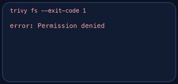
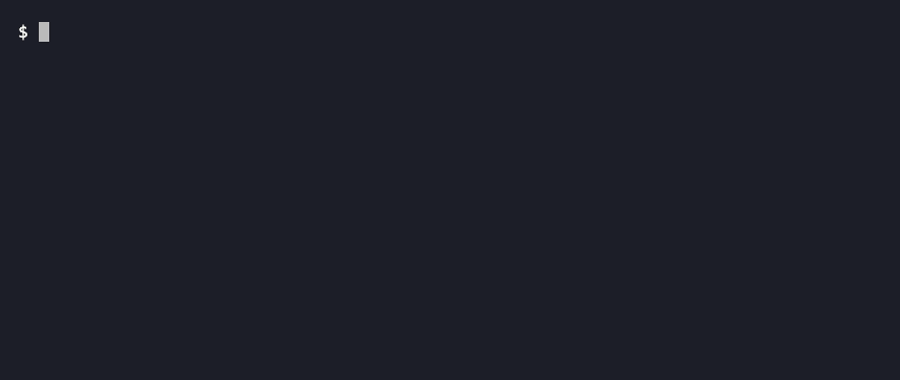

<p align="center"></p>

| | |
|-|-|
| **Time** | 90-105 min |
| **Cost** | free |
| **You need** | Trivy (`brew install trivy`, or the release page), Python 3, git and a terminal |

## How this lab works

1. **Fork** this repository to your own GitHub account (button at the top right).
2. Clone **your fork** in your Ubuntu environment (WSL on Windows, your OrbStack machine on Mac).
3. Read the lab below (the same text is in [`LAB.md`](LAB.md)) and follow the mission.
4. Answer the questions in [`SUBMISSION.md`](SUBMISSION.md). Where a question asks for output, paste it in a code block. No screenshots needed.
5. Commit and push. Open the **Actions** tab of your fork (click *I understand my workflows, go ahead and enable them* the first time). The **Lab check** shows what is still missing.
6. When the check is green, **submit the URL of your fork** in the course platform.

> [!NOTE]
> The check only looks at your answers and any files the lab asks you to commit. Your instructor reads your work and may ask you to explain any line.

<p align="center"></p>

## 🎬 The situation

<p align="center"></p>

A pull request has appeared in your queue. The author is a scanner bot, the title is *"Security findings: please remediate"*, and the review comments are long and red:

> **bot** `requirements.txt`: 11 vulnerable dependencies. Merge blocked.
>
> **bot** `config/old.env`, line 4: this looks like an AWS access key. Merge blocked.
>
> **bot** `Dockerfile`: runs as root, pulls `latest`, downloads a file without checking it. Merge blocked.
>
> **bot** *"please remediate before the next release"*

Anyone can run a scanner. The job is what comes after: **deciding** what each finding means, **fixing** what can be fixed, **justifying in writing** what cannot (with a name and an expiry date, so "temporary" never means "forever"), and **putting the scanner in the pipeline** so the list cannot grow back unnoticed. Last, you will see why a pipeline that was green yesterday can be red this morning without anyone touching the code.

> [!IMPORTANT]
> **Your mission**
> - Run the scanner and read its report: vulnerabilities, secrets, misconfigurations
> - Fix the dependencies, remove the leaked keys properly, harden the Dockerfile
> - Record each decision in `TRIAGE.md`
> - Add the scan to GitHub Actions: on pull requests, on pushes to main, and every night
> - Pass the checker, which scans your work exactly as the pipeline would

**Time:** 90-105 min | **Cost:** free | **You need:** Trivy (`brew install trivy`, or the installation page for Linux and WSL), Python 3, git and a terminal.

<p align="center"></p>

## Part 0 - Check out the pull request

Fork this repository, clone your fork and run:

```bash
./setup.sh
```

It checks that Trivy is installed and writes `service/settings.py` with **two fake keys** (random every time, shaped like AWS credentials) as if a colleague had committed them. Read the service: `service/main.py`, `service/requirements.txt`, the `Dockerfile`, `tests/`. The service is tiny on purpose.

<p align="center"></p>

## Part 1 - Read the review comments

<p align="center"></p>

```bash
trivy fs --scanners vuln,secret,misconfig --severity HIGH,CRITICAL --ignore-unfixed .
```

The summary table counts findings per target. Three different kinds of finding hide in it:

| Kind | Where it comes from | How you fix it |
|------|---------------------|----------------|
| **Vulnerability** | a dependency (or OS package) with a published CVE | upgrade to the fixed version, or replace the package |
| **Secret** | a key, token or password in a file | remove it from the code **and rotate it** |
| **Misconfiguration** | a Dockerfile or infrastructure file that breaks a rule | change the file |

`--ignore-unfixed` hides findings for which no fixed version exists: you cannot fix those today, so failing the build on them only teaches people to ignore the build. Which policy you choose is a decision, not a default.

> [!NOTE]
> **Think** For one CVE in the list, read its page (the link in the table). What does the vulnerable function do and does *your* code call it? "Not reachable" is a reason to schedule an upgrade, never a reason to leave the finding for ever. Why?

<p align="center"></p>

## Part 2 - Dependencies

Upgrade each vulnerable package. Ask PyPI for the newest release instead of guessing:

```bash
python3 -m venv /tmp/v && /tmp/v/bin/pip index versions requests
```

Pin **exact versions** with `==`. A scanner cannot judge `requests>=2`, and neither can a reproducible build. Run the unit tests (`python3 -m unittest discover -s tests`) to prove the service still works, then scan again.

If a package you pinned still shows a finding with a newer fixed version, the vulnerability database has moved on since the version you chose. That is not a mistake in your pin; it is how this work goes. Move up again.

<p align="center"></p>

## Part 3 - The leaked keys

Open `service/settings.py`. Two things are true at once:

1. The keys **are in git history** and in every clone and fork. Deleting the lines does not undo that.
2. The only way to make a leaked key harmless is to make it **useless**: deactivate and rotate it in the cloud account. In a real incident that is step one, before you touch the code, followed by a look at the audit log (CloudTrail) to see whether anyone used it.

Then fix the code: the keys must come from the environment (`os.environ`), the file must contain no key, and the tests must still pass (they set dummy values). Write down in `TRIAGE.md` the steps of the real incident, in order.

> [!NOTE]
> **Predict** After you remove the keys, what does `git log -p -- service/settings.py` show? What would it take to remove them from history, and what would still not be fixed by it?

<p align="center"></p>

## Part 4 - The Dockerfile

Fix what the scanner reports and what a reviewer would: a pinned base image (`python:3.12-slim`, not `latest`), no `ADD` of a remote URL (use `COPY`, or download with a verified checksum), a non-root `USER`, a `HEALTHCHECK`, `--no-cache-dir` for pip, and if you use `apt-get`, `--no-install-recommends` and the lists removed in the same `RUN`.

<p align="center"></p>

## Part 5 - The scanner in the pipeline

Write `.github/workflows/security.yml`:

- runs on pull requests, on pushes to `main`, and **on a schedule** (once a day);
- `permissions: contents: read` and a job `timeout-minutes`;
- every action pinned to a commit SHA. The Trivy action `aquasecurity/trivy-action` v0.34.0 is `c1824fd6edce30d7ab345a9989de00bbd46ef284`, and `actions/checkout` v4.2.2 is `11bd71901bbe5b1630ceea73d27597364c9af683`;
- scans the filesystem for vulnerabilities, secrets and misconfigurations, with severity `HIGH,CRITICAL`, `ignore-unfixed` and `exit-code: "1"` so that the build **fails**.

If something truly cannot be fixed, add it to `.trivyignore` as one line: the CVE, the reason, the owner and an expiry date. The checker accepts at most two entries, all justified and all in the future.

> [!NOTE]
> **Think** The schedule is there because of the next question: your code did not change last night, and the pipeline went from green to red. What changed? Is the pipeline wrong? Who looks at it in the morning, and what should the failed run tell them?

<p align="center"></p>

## Part 6 - Prove it

<p align="center"></p>

Fill in `TRIAGE.md` (what you found, what you decided and why, for each group), then:

```bash
./verify.sh
```

It runs Trivy as the pipeline would, checks that your fixes are real (upgraded and not deleted, keys from the environment, the tests still pass), reads your Dockerfile and your workflow, and checks `.trivyignore`. Fix what is red and run it again until it ends with **ALL CHECKS PASSED**.

> [!TIP]
> **Stuck?** A package still shows a finding: use the "Fixed Version" column and then the newest version on PyPI. `trivy` cannot download its database: check your connection; the first run needs it. The secrets check still fails: the key may be in a comment or in `settings.py.orig` or another file; scan again with `-f table`. The tests fail with `KeyError: AWS_ACCESS_KEY_ID`: they set dummy values only if you read the variables from `os.environ` at import time, as the tests expect. The workflow check fails: `exit-code` must be the string `"1"` and the actions must be pinned to 40-character SHAs.

<p align="center"></p>

## Level up (optional)

- Scan the built image as well: `docker build -t svc . && trivy image svc`. Where do the OS-package findings come from and how would you reduce them (a smaller base, distroless)?
- Add Dependabot (`package-ecosystem: pip` and `github-actions`) and look at the pull requests it would open. How do you stop them from being ignored?
- Generate an SBOM with `trivy fs --format cyclonedx` and attach it to a release.
- Add `gitleaks` as a pre-commit hook so the next key never reaches a commit. Which of the two controls (hook, pipeline) can a developer bypass?

<!-- teardown:start (generated by labs.py, do not edit) -->
## Tear down (mandatory)

<p align="center"></p>

Resources left behind cost money, keep doors open and pollute the next lab. Removing what you created is part of the job, so it is part of the submission: **you must prove it is gone**.

Do this **last**, after you have pasted your `verify` output into `SUBMISSION.md` (once you tear down, the lab can no longer be verified).

1. Nothing runs outside your repository. Run `./teardown.sh` to remove the scanner cache of this lab, then `./verify-teardown.sh`.

Then run the proof:

```bash
./verify-teardown.sh
```

It prints a list of checks and must end with **TEARDOWN VERIFIED**. If it reports leftovers, remove them and run it again. Paste the full output in your submission.
<!-- teardown:end -->

<!-- submission:start (generated by labs.py, do not edit) -->
## 📬 Submission

Answer the questions in `SUBMISSION.md` in **your fork** (paste output in code blocks where asked), push, then submit the **URL of your fork**.

**Files to commit**

- `service/requirements.txt`, `service/settings.py`, `Dockerfile`: fixed
- `.github/workflows/security.yml`: the scan in the pipeline
- `.trivyignore`: only justified exceptions
- `TRIAGE.md`: your decisions

**Questions to answer**

1. Paste the summary table of the first `trivy fs` run (counts per target). What is the difference between a vulnerability, a secret and a misconfiguration finding? Which of them can you fix by changing a file, and which need an action outside the repository?
2. The two leaked keys: you removed them from the file. Why is that not enough? List, in order, what you do in a real incident (hint: the first step is not in git). What does `git log -p` still show?
3. Pick two CVEs from the list. For each: what is it, what is the fixed version, does your code even reach the vulnerable function, and why do you upgrade anyway? Which is "reachable" and which is not?
4. What does `--ignore-unfixed` do and why is it a policy decision? What does a `.trivyignore` entry need (reason, owner, expiry) so that it does not become a permanent hole?
5. Show your pipeline step. Why does it fail the build on HIGH and CRITICAL but only report MEDIUM? What happens to a developer's morning if it fails on every finding, including LOW?
6. The database of known vulnerabilities changes every day. Your code did not. Why can a build that passed yesterday fail today, and is that a bug in the pipeline? What do you do about it (scheduled scans, Dependabot)?
7. Paste the output of `./verify.sh`. It must end with **ALL CHECKS PASSED**.
8. **Tear down.** Paste the output of `./verify-teardown.sh`. It must end with **TEARDOWN VERIFIED**.
<!-- submission:end -->
